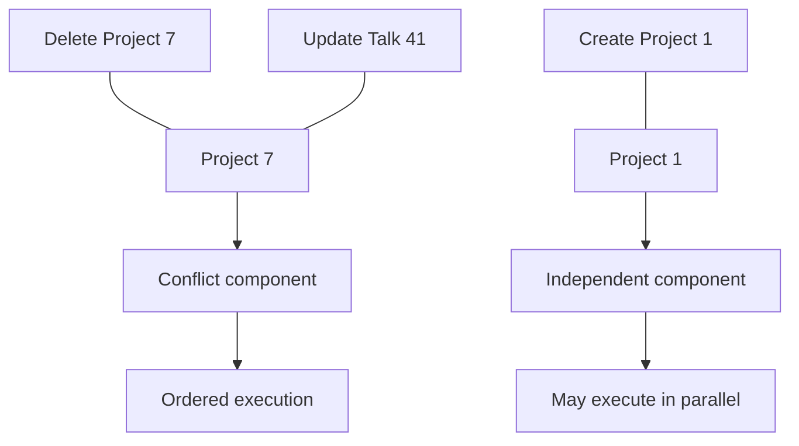

# Resolutor

**Plan work against shared resources before execution.**


Resolutor is a domain-agnostic execution planner. It resolves the resources touched by incoming tasks, compiles their conflicts into a graph, and creates an immutable `ExecutionPlan` so conflicting work can be sequenced while independent work runs concurrently.

**Plan first. Parallelize safely. Resume work.** Resolutor coordinates through planning rather than acquiring per-resource runtime locks; applications still own their business semantics and correctness.

**Docs:** [Developer guide](docs/README.md) · [Architecture](docs/architecture.md) · [Design](docs/design.md) · [Configuration](docs/configuration.md) · [API](docs/api.md)

## How it works


Tasks that touch the same resource are connected in the conflict graph. The planner groups work so conflicting tasks respect ordering constraints and independent work can proceed concurrently.



The diagrams describe the planning model, not a guarantee that every deployment or adapter is enabled. See the [design](docs/design.md) for details.

## Why Resolutor?

| Need | Resolutor's approach |
| --- | --- |
| Coordinate tasks touching shared business data | Resolve resource footprints before dispatch |
| Reduce lock contention in workers | Plan conflicts ahead of execution |
| Keep planning inspectable | Treat `ExecutionPlan` as an immutable intermediate representation |
| Recover long-running work | Persist task progress and resume from cursors |
| Adapt to different domains | Integrate resource semantics through `ResourceGraphPort` |

Resolutor is a planner, not a general-purpose workflow engine. Use a workflow orchestrator when you need rich workflow authoring, timers, or cross-system workflow semantics; use a simple queue when tasks do not conflict.

## Quick start

Start the local stack (PostgreSQL and Resolutor; Kafka is optional and off by default):

```bash
docker compose up -d
```

Submit a task:

```bash
curl -X POST http://localhost:8080/api/v1/tasks \
  -H "Content-Type: application/json" \
  -d '{"topResourceClass":"project","topResourceId":"7","searchDsl":{},"payload":{}}'
```

Inspect the latest plan:

```bash
curl http://localhost:8080/api/v1/plans/latest
```

The compose profile uses the task's top-level resource as its resource footprint. For integration with a business resource graph, configure the [resource-graph endpoint](docs/configuration.md).

## Core concepts

- **Task** — a unit of work with a top-level resource, payload, state, and resumable cursor.
- **Resource** — an opaque `{class, id}` identity; the application supplies resource semantics.
- **Conflict graph** — connects tasks whose resource footprints overlap.
- **ExecutionPlan** — an immutable representation of ordered groups and execution waves.
- **Backpressure** — probabilistic, per-resource-class admission control using in-memory sketches and buffers.

## Runtime and integration

- **Java 21** and Spring Boot 3; Gradle multi-project build.
- **PostgreSQL** is the required external dependency.
- **Kafka dispatch** is optional; the default dispatch mode is in-process.
- **Resource resolution** is provided through `ResourceGraphPort`; the HTTP adapter can call an external graph service.
- **Observability** includes Actuator health endpoints and Prometheus metrics.

See [configuration](docs/configuration.md) for profiles, dispatch modes, planner options, and environment variables.

## API

Base path: `/api/v1`.

| Method | Endpoint | Purpose |
| --- | --- | --- |
| `POST` | `/tasks` | Ingest a task |
| `GET` | `/tasks/{id}` | Read status and progress |
| `POST` | `/tasks/{id}/progress` | Update progress |
| `POST` | `/tasks/{id}/complete` | Mark a task complete |
| `GET` | `/plans/latest` | Inspect the latest plan |

Errors use `application/problem+json`. Interactive OpenAPI is available at `/swagger-ui.html`. See the [API reference](docs/api.md) and the [developer book](docs/README.md).

## Development

```bash
./gradlew test
```

The project uses JUnit 5, Testcontainers, ArchUnit, and static-analysis/formatting checks. See the [developer guide](docs/README.md) for local development and examples.

## Status and roadmap

The [implementation plan](docs/implementation-plan.md) identifies the **v1 core planner as implemented**; cutting a 1.0 release remains a manual release step. It describes v2–v4 as planned work. Consult that plan for the phase-by-phase source of truth rather than treating roadmap items as released capabilities.

- **v1:** conflict planning, resumable cursors, in-process dispatch, and basic backpressure.
- **v2:** first-class plan IR and extensible optimisation passes.
- **v3:** graph colouring for more parallelism within conflict components.
- **v4:** cost-aware scheduling and locality/backpressure-aware ordering.

## Contributing

Useful areas include optimisation passes, resource-graph adapters, dispatch adapters, benchmarks, and examples. Start with the [developer documentation](docs/README.md) and [design](docs/design.md).

## License

Apache 2.0 — see [LICENSE](LICENSE).

*Resolutor — Plan. Parallelize. Protect.*
